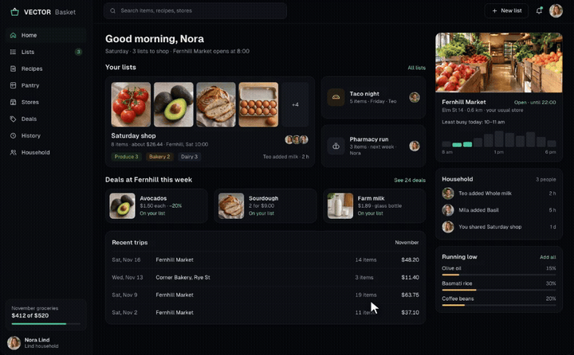

# Aisle List

**Our shopping list was in the order we added things. One click put it in the order of the store.**



**Live demo:** [veraetogrex-portfolio.github.io/aisle-list](https://veraetogrex-portfolio.github.io/aisle-list/) · **Mockup:** [full-screen version](https://veraetogrex-portfolio.github.io/aisle-list/mockup/aisle-list.html)

A family shopping list screen: By aisle groups 8 items under Produce, Bakery and Dairy & eggs one row at a time (FLIP), the counter reaches 8 of 8 and the store plan lights aisles 1, 4, 7 with the route. Vanilla HTML/CSS/JS, zero dependencies.

## Try it

- Click the "Saturday shop" card on the home screen. The list opens with 8 items in the order the family added them; every row shows its aisle tag (Produce · 1, Bakery · 4, Dairy · 7).
- Press By aisle. Three aisle headers appear, then the rows lift off one at a time, top to bottom, and land under Produce · Aisle 1, Bakery · Aisle 4 and Dairy & eggs · Aisle 7. The counter climbs to "8 of 8 items in place" and the total stays $26.44.
- Watch the store plan on the right: aisles 1, 4 and 7 light up with 3, 2 and 3 items, and the route reads "Aisles 1 → 4 → 7 · about 12 min".
- Press As added, even in the middle of the sort. The rows go back to the order they were added, the headers and the plan clear.
- The Lists breadcrumb and Home / Lists in the sidebar switch screens; the list keeps its order.
- Keyboard: Tab to the "Saturday shop" card or to As added / By aisle and press Enter.
- With reduced motion on, the list sorts at once.

## Use it

Three files and the photos, no build step, no dependencies:

```
index.html   markup
style.css    styles
script.js    logic
assets/      the photos (generated, free to reuse with the code)
```

Download the repo and open `index.html`, or copy the files into your project. Set `data-assets` on `<section class="ab">` to the folder with your photos.

## License

MIT
